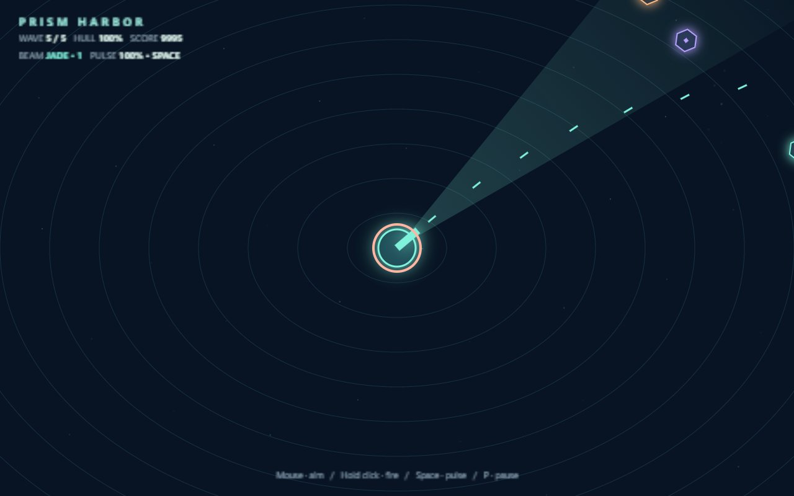

# 棱镜港 / Prism Harbor

[在线使用 / Open in browser](https://xialin99.github.io/makefun-prism-harbor/)

[中文](#中文) · [English](#english)

## 中文

原创离线灯塔防守游戏，玩家抵御五波漂流的星际袭击者。

### 本地运行

运行 `node serve.ts`，用桌面 Chrome 打开 `http://localhost:8080`，按照画面中的控制说明游玩。

页面默认显示简体中文，可以在界面选择 English。

命令行提示默认显示中文。设置 `MAKEFUN_UI_LANG=en` 可显示英文。

## English

An original offline lighthouse-defense game. Protect the harbor light through five waves of star raiders.

### Run locally

Run `node serve.ts`, open `http://localhost:8080` in desktop Chrome, and follow the on-screen controls.

The interface opens in Simplified Chinese. Use the language menu to switch to English.

Set `MAKEFUN_UI_LANG=en` for English terminal messages.

[中文技术说明](README.details.zh.md) · [English technical notes](README.details.md)

[make.fun 赛事 / Original bounty](https://make.fun/bounty/best-game-01)

## 许可证 / License

MIT. See [LICENSE](LICENSE).

赛事模板组件的授权见 [LICENSE-makefun.txt](LICENSE-makefun.txt)。

Kit components are covered by [LICENSE-makefun.txt](LICENSE-makefun.txt).

